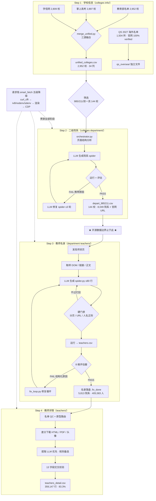

# Forager Faculty 🎓

**简体中文** | **[English](README_EN.md)**


> **Forager**（觅食者）—— 像觅食的蜜蜂根据花蜜信号调整路径一样，这个
> LLM 驱动的自适应采集框架根据评估器的失败原因信号，迭代修正提取规则。
> 采集对象是**高校教师**：四阶段流水线（学校 → 院系 → 教师名录 → 教师详情）
> 采集中国高校官网公开发布的教师队伍信息，核心是一个
> **「评估 → 修复 → 重评」闭环**：让 Agent 自己发现采集质量问题、
> 携带结构化原因迭代修复 spider，而不是靠人肉抽查和改规则。
>
> **开源数据边界**：本仓库只分发到「院系 URL 清单」层级（学校属性 + 院系名称/官网 URL，
> 以及 QS 海外高校名单）。教师名录、教师详情的**采集框架与机制完整保留**，
> 但其数据产物不随仓库分发，见 [数据边界](#数据边界)。全量运行（144 校）的聚合统计见
> [docs/采集结果统计报告.md](docs/采集结果统计报告.md)。

## 目录

- [特性一览](#特性一览)
- [为什么是 Forager](#为什么是-forager)
- [架构总览](#架构总览)
- [实战战绩](#实战战绩)
- [核心机制](#核心机制)
- [典型站点案例](#典型站点案例)
- [快速开始](#快速开始)
- [文档导航](#文档导航)
- [数据边界](#数据边界)
- [未来发展方向](#未来发展方向)
- [目录结构](#目录结构)
- [免责声明](#免责声明)
- [许可证](#许可证)

## 特性一览

| | 特性 | 说明 |
|---|---|---|
| 🔁 | **评估驱动的质量闭环** | 8 维评估器给每份产物打分，FAIL 携带结构化原因进入修复循环（≤3 轮），回滚保护 + 确定性模板兜底 |
| 🧩 | **自适应任意站点结构** | LLM 阅读页面样本（DOM 结构/链接/文本）**设计提取规则**——产出 BeautifulSoup 选择器 + 正则的确定性 spider，而非逐页喂给 LLM 提取；规则零 token 可复跑、结果可复现，没见过的网站也能跑 |
| 📝 | **实战沉淀的提示词体系** | 每条提示词硬规则背后是一类实测翻车现场；修复循环发现新失败模式即固化为提示词规则，与知识库联动持续进化 |
| 🌐 | **五级降级请求栈** | `curl_cffi` TLS 指纹 → `iv8`/`nodenv`/`sdenv` 纯 CPU 破瑞数 JS 挑战 → 浏览器渲染 → CDP 常驻实例，逐级自动降级 |
| ✅ | **检验结果，绝不假成功** | 每份产物必须过评估器（8 维 + 硬门禁）才算数：FAIL 携带结构化原因驱动重试（≤3 轮）+ 回滚保护；144 校院系采集 100% 通过率、8,049 院系平均 99.3 分；424 项离线单测守护框架本身 |
| 🔑 | **LLM 双模式接入** | 默认单 token 直连零配置；可选 token manager 动态池：失效自动摘除、轮询分配、sticky 会话 |
| 🛡 | **工程化运行时** | LLM 熔断器、系统资源三档守卫、看门狗自愈、失败院系冻结账本 |

## 为什么是 Forager

| 传统爬虫的做法 | Forager 的做法 |
|---|---|
| 每个网站写死一套 CSS 选择器，站点改版即失效 | LLM 读页面样本**生成提取规则**（BeautifulSoup 选择器 + 正则），没见过的新站现场生成新规则 |
| 靠人肉抽查发现漏采错采，发现问题再改代码 | **8 维评估器**给每份产物打分，FAIL 携带结构化原因驱动修复循环（≤3 轮 + 回滚保护 + 确定性兜底） |
| 提取过程黑盒，结果不可复现、规则不可审计 | 规则是 **≤80 行确定性脚本**：同输入同输出，零 token 可复跑，人能读能改 |
| 反爬一挂全停，维护靠救火 | **五级降级请求栈** + 三种纯 CPU 瑞数破解路径（iv8 / nodenv / sdenv），逐级自动降级 |

一句话：**把「怎么写爬虫」变成「怎么评价爬虫」**——规则生成和规则验证都交给
Agent 闭环，人只需要定义什么算「采对了」。这也意味着框架的能力是随案例库增长的：
每修复一类新站点，下一所大学直接绕坑（详见[典型站点案例](#典型站点案例)）。

## 架构总览

### 四阶段流水线（全景大图）



| 阶段 | 目录 | 职责 | 入口 |
|---|---|---|---|
| Step 1 | `colleges info/` | 三源融合出全国高校主名单 + QS 海外名单 | 各子目录采集脚本 |
| Step 2 | `colleges department/` | 每校官网提取二级院系 + URL | `orchestrator.py` |
| Step 3 | `department teachers/` | 院系师资页 → 教师名录 | `collect_phases.py` / `evaluate_teachers.py` / `fix_loop.py` |
| Step 4 | `teachers/` | 教师个人页 → 13 字段结构化详情 | `download_stage.py` / `extract_all_details.py` |

阶段间的衔接是**纯文件契约**：上游产物 CSV 即下游唯一输入（`templates/contract.py`
是列名的单一事实来源）。任何阶段都可以单独重跑——spider 脚本与数据产物同目录
存放并带溯源 hash，评估器据此保证「有数据 ⟺ 有可运行的 spider」。

### 每个阶段都是同一个 Agent 循环

```
生成 spider → 运行 → 评估器多维度打分
    ▲                        │
    │                   PASS ✅ 产出落盘
    │                   FAIL ❌ 携带结构化原因
    │                        ▼
    └──── LLM 修复 spider ←──┘   （≤3 轮；连败走确定性兜底模板）
```

四个阶段共享这一模式，只是评估维度和 spider 形态不同——详见
[docs/核心机制.md](docs/核心机制.md)。

## 实战战绩（144 校全量运行）

一句话总结：这套框架**无人值守**跑通了 **405,583 位教师的完整采集链路**——
从学校官网出发，自动发现院系、现场生成提取规则、逐级评估验证，最终产出
**359,147 行结构化教师详情**，并留存 43 GB 原始页面存档。

| 阶段 | 规模 | 质量验证 |
|---|---|---|
| 学校 → 二级院系 | 2,952 校筛选 → 144 校 / **8,049 个院系**（名称 + 官网 URL） | 四维评估器通过率 **100%**，平均 **99.3 分**（131 所满分） |
| 院系 → 教师名录 | **5,813 个院系名录 · 405,583 位教师** | 8 维评估 + 硬门禁 + 修复循环终验，PASS 才落盘 |
| 名录 → 教师详情 | **359,147 行详情**，83.3% 含 13 字段 ≥1 项 | 字段错位交叉校验；下载/提取解耦，重提取不重抓取 |
| 原始存档 | **43 GB**：375,564 HTML + 4,447 PDF + 67,883 头像 | 差分下载，内容不变永不重复抓取 |

- 反常规站点 16 案例全部修复归档：清华 AI 学院 `title` 属性姓名、北大经济学院
  JS 改写链接、重大 43 页 PDF 名单、中南财大全站 AES-GCM 壳……
- **424 项离线单测**守护框架本身（无网络 / 无 LLM / 无浏览器可全量回归）
- 统计口径与质量验证体系见 [docs/采集结果统计报告.md](docs/采集结果统计报告.md)

**已知不足（诚实声明）**——以下形态仍有残余适配缺口，框架持续收敛中：

- **JS 渲染型 / 纯 API 驱动站点**：教师数据不在 HTML 里（XHR 接口 / JS 数组 /
  iframe 深层平台）。tsites、通元等四平台家族已适配，长尾仍有残余
- **空模板页**：约 164 个院系「有导航无名单结构」，需子页 / JS 端点 / CDP
  渲染三查逐个判定
- **瑞数严格档硬墙**：29 个院系维持 blocked 终态（判定为网络层问题，不再投入
  代码破解）
- **登录墙站点**：约占全库 4%，站方页面权限所致，上游名单本身正确

边界内的质量由评估器兜底——凡 PASS 落盘必过 8 维评估 + 硬门禁，不存在「假成功」；
边界外的残余都有账本记录，见统计报告的「质量验证」节。

## 核心机制

深度设计拆分为独立文档（每个文档顶部都有英文摘要）：

| 文档 | 内容 |
|---|---|
| [docs/核心机制.md](docs/核心机制.md) | 评估-修复-重评循环（8 维评估表）、自适应提取规则（LLM 设计规则/硬门禁/模式库）、站点原型路由 |
| [docs/瑞数反爬解决方案.md](docs/瑞数反爬解决方案.md) | 五级降级请求栈、三层对抗模型、三条纯 CPU 求解器（iv8/nodenv/sdenv）原理对比、cookie 生命周期、排查手册 |
| [docs/LLM接入与令牌池.md](docs/LLM接入与令牌池.md) | 单 token / 动态 token 池、密钥解析优先级、失效切换、三级分配策略、熔断器 |

## 典型站点案例

全库 5,287+ 院系站点绝大多数是标准 CMS 结构；少数反常规站点曾整院被误判为
「不可达 / 无师资 / JS 壳」。每个案例都沉淀为一个修复机制，六大家族代表：

| 站点 | 典型特点 | 框架对策 |
|---|---|---|
| 重庆大学-辛辛那提联合学院 | 师资名单在 **43 页 PDF** 里，HTML 零名单，渲染兜底也提取 0 人 | PDF 专项解析 |
| 重庆大学土木工程学院 | 首页是**语言选择页**，入口全是图片链接、无锚文本 | 入口选择页跟随（61→263 人） |
| 北京大学经济学院 | 静态 href 是 **JS 改写型相对链接**，拼接访问必 404 | 渲染取真实 href |
| 中南财经政法大学 | 全站 **AES-GCM 加密壳**，无瑞数特征码，被当成功页返回 | 纯 CPU 壳破解 |
| 长安大学 | 每人一个 **`list.htm` 详情页**（全库 6,291 条中仅 0.9% 是真列表） | 豁免判定 |
| 北京大学计算机学院 | **字母索引覆盖数字分页**，只抓数字分页漏掉一半 | BFS 分页闭包（26→133 人） |

完整案例库（16 个案例 · 6 个形态家族 + 判别纪律）见
[docs/特殊网站结构案例库.md](docs/特殊网站结构案例库.md)。

## 快速开始

```bash
# 0. 环境要求: Python >= 3.14（uv 管理）、Node.js 24（仅瑞数 sdenv 路径需要）
uv sync
npm ci                # 仅 util/rsenv/ 瑞数补环境需要，不用该功能可跳过

# 1. 配置（模式 A：填三项即可跑通主体）
cp .env.example .env  # LLM_API_KEY / LLM_BASE_URL / LLM_MODEL

# 2. Step 3 教师名录（示例：苏州大学全部院系；--dept 商学院 可采单院系）
uv run --project . python "department teachers/collect_phases.py" --school 苏州大学
uv run --project . python "department teachers/evaluate_teachers.py" 苏州大学   # 评估
uv run --project . python "department teachers/fix_loop.py" 苏州大学 --resume   # 修复 FAIL

# 3. Step 4 教师详情（下载 + 提取）
uv run --project . python teachers/download_stage.py --all --teacher-workers 5
uv run --project . python teachers/extract_all_details.py

# 4. 单元测试（无网络 / 无 LLM / 无浏览器）
uv run --project . python -m unittest discover -s tests
```

产物落盘在 `department teachers/output/<学校>/<院系>/teachers.csv` 与
`teachers/<学校>/`（均已 `.gitignore`，不会误提交）。所有可调参数见
`.env.example`（约 50 项，按 LLM / 代理 / 浏览器 / 反爬 / 资源守卫 / 流水线分节，
含注释）。

## 文档导航

| 文档 | 内容 |
|---|---|
| [docs/核心机制.md](docs/核心机制.md) | Agent 循环 / 规则生成 / 硬门禁 / 原型路由 |
| [docs/特殊网站结构案例库.md](docs/特殊网站结构案例库.md) | 反常规站点形态档案（16 案例 · 6 家族 + 判别纪律） |
| [docs/瑞数反爬解决方案.md](docs/瑞数反爬解决方案.md) | 请求栈五级降级与瑞数对抗 |
| [docs/LLM接入与令牌池.md](docs/LLM接入与令牌池.md) | LLM 接入双模式与令牌池 |
| [docs/安全与数据边界.md](docs/安全与数据边界.md) | 发布审计记录、数据分级、合规工作流 |
| [docs/采集结果统计报告.md](docs/采集结果统计报告.md) | 144 校全量运行的聚合统计 |
| [`colleges info/README.md`](<colleges info/README.md>) | Step 1 学校信息（三源融合 + QS 海外名单） |
| [`colleges department/README.md`](<colleges department/README.md>) | Step 2 二级院系 |
| [`department teachers/README.md`](<department teachers/README.md>) | Step 3 教师名录（全景工作流） |
| [`teachers/README.md`](teachers/README.md) | Step 4 教师详情（两步解耦）；`teachers/DESIGN.md`、`quality_criteria.md`、`dept_rule_format.md`、`concurrency_playbook.md`、`resource_strategy.md` |

## 数据边界

| 层级 | 是否随仓库分发 |
|---|---|
| 学校信息（名称/主管部门/985/211/排名等公开属性） | ✅ `colleges info/unified_colleges.csv` |
| 海外高校名单（QS 2027：校名/排名/官网 URL） | ✅ `colleges info/qs_oversea/qs_rankings_2027_with_website.csv`（1,504 所，官网 100% verified） |
| 院系清单（学校 → 院系名称 + 院系官网 URL） | ✅ `colleges department/depart_985211.csv` + `depart_985211.jsonl` |
| 教师名录（姓名 + 详情页 URL） | ❌ 不分发；运行 `department teachers/` 框架自行采集 |
| 教师详情（13 字段 + 原始页面） | ❌ 不分发；运行 `teachers/` 框架自行采集 |

所有运行时输出目录（`colleges department/output/`、`department teachers/output/`、
`teachers/<学校>/`）均在 `.gitignore` 中排除——**spider 脚本、评估报告、采集数据
一律在运行时生成，不随仓库分发**；仓库只包含经过验证的采集框架本身。
发布前安全审计记录与提交前合规工作流见
[docs/安全与数据边界.md](docs/安全与数据边界.md)。

## 未来发展方向

| 方向 | 现状（数据已就绪） | 待办（规划，未执行） |
|---|---|---|
| **海外优质高校** | QS 2027 名单已随仓库分发（`qs_oversea/`，1,504 所官网 100% verified） | 四阶段框架向海外官网适配：Faculty/School 院系命名、英文姓名与 Staff Directory、Cloudflare/Akamai 挑战 |
| **国内普通学校** | `unified_colleges.csv` 已含 2,808 所双一流之外学校 | ① 补全 143 所缺官网 URL（当前覆盖 94.9%，复用 `qs_oversea/` 的搜索验证方法论）；② 整批进入四阶段管道（专科/职业院校师资页形态适配） |

框架能力随案例库持续进化：每修复一类反常规站点，即沉淀为
[docs/特殊网站结构案例库.md](docs/特殊网站结构案例库.md) 的新条目与提示词硬规则。

## 目录结构

```
├── colleges info/             # Step 1: 学校信息（三源融合, 2,952 校）
│   └── qs_oversea/            #   QS 2027 海外名单（1,504 所 + 官网验证链, 独立文件）
├── colleges department/       # Step 2: 二级院系（框架 + 8,049 院系 URL 清单——开源数据边界）
├── department teachers/       # Step 3: 教师名录采集 Agent
│   ├── collect_phases.py      #   主流水线（找师资页→生成 spider→运行→评估→修正）
│   ├── evaluate_teachers.py   #   8 维评估器
│   ├── fix_loop.py            #   修复循环（回滚保护/断点续传/知识库学习）
│   ├── templates/             #   spider 模板 + 数据契约（contract.py）
│   └── knowledge/             #   页面结构模式知识库（自进化）
├── teachers/                  # Step 4: 教师详情采集 Agent（两步解耦）
├── token manager/             # LLM token 池（可选负载均衡, 含示例结构）
├── util/                      # 共享请求栈（smart_fetch 五级降级/瑞数/浏览器池/LLM 网关）
├── docs/                      # 核心机制 / 请求栈 / LLM 接入 / 安全边界 / 统计报告
├── tests/                     # 424 项单元测试（离线可跑）
├── .env.example               # 配置模板（约 50 项, 分节注释）
└── pyproject.toml             # uv 项目定义
```

各阶段内部的设计细节见各自目录下的 `README.md` / `DESIGN.md`。

## 免责声明

- 本框架仅用于采集**高校官网公开发布**的信息，请遵守目标站点的
  robots.txt、服务条款与当地法律法规；采集频率与并发请保持克制
  （框架内置了请求节流与资源守卫，请不要调高到对站点造成压力的程度）
- 教师个人信息受法律保护（如《个人信息保护法》）。使用本框架采集到的
  任何个人信息，其存储、使用与分享的责任由使用者自行承担；
  **请勿将采集结果用于违反法律或侵犯他人权益的用途**
- 仓库不包含也不分发任何已采集的教师个人数据；`token manager/`
  只包含池管理代码与示例结构，不含任何真实密钥

## 许可证

[MIT](LICENSE)
